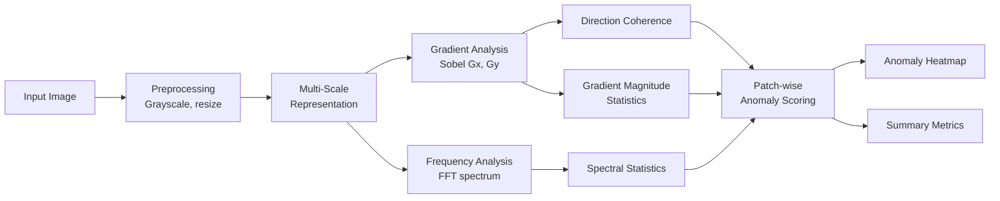
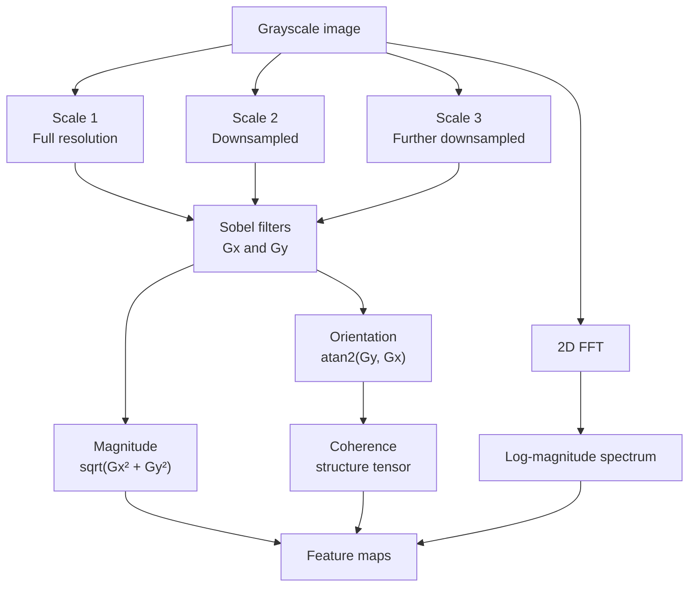
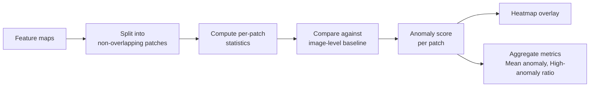
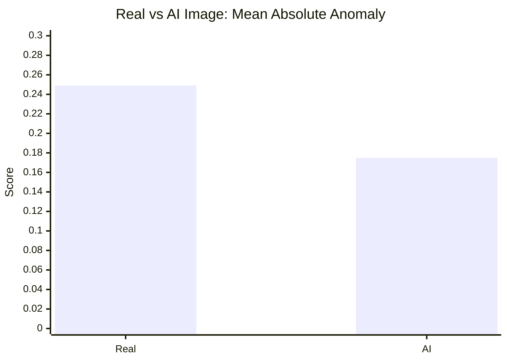

<div align="center">

# 🔍 AI Image Anomaly Detection

### Gradient and Frequency-Based Explainable Detection of AI-Generated Images

*A training-free, interpretable approach that looks for statistical traces of image generation using gradients, the Fourier spectrum and patch-level analysis.*


</div>

---

## 📑 Table of Contents

1. [Overview](#-overview)
2. [Problem Statement](#-problem-statement)
3. [Approach](#-approach)
4. [System Architecture](#-system-architecture)
5. [Theory and Concepts](#-theory-and-concepts)
6. [Metrics Explained](#-metrics-explained)
7. [Results](#-results)
8. [Key Insight and Analysis](#-key-insight-and-analysis)
9. [Visual Output](#-visual-output)
10. [Tech Stack](#-tech-stack)
11. [Repository Structure](#-repository-structure)
12. [Getting Started](#-getting-started)
13. [Limitations](#-limitations)
14. [Future Work](#-future-work)
15. [Contributing](#-contributing)
16. [Author](#-author)

---

## 🔎 Overview

Generative models can now produce images that are hard to tell apart from photographs. Most detectors are **trained classifiers** (often CNNs) that behave as black boxes and can fail on generators they have not seen.

This project explores a different question:

> **Can we detect AI-generated images *without training a machine learning model*?**

It uses classical image processing, namely **Sobel gradients, multi-scale analysis, Fourier (FFT) frequency analysis, and gradient direction coherence**, and combines them into a **patch-wise anomaly map** that can be visualised as a heatmap. Every score is computed from interpretable signals, so the result is **explainable**.

---

## ❗ Problem Statement

- AI-generated images are increasingly realistic and widely shared.
- Learned detectors need large labelled datasets and may not generalise to new generators.
- Their decisions are hard to explain: *why* was this image flagged?

**Goal:** investigate whether hand-crafted, low-level statistical features (gradients and frequency content) can separate real and AI-generated images, and understand what these features do and do not capture.

---

## 🧠 Approach

| Component | Purpose |
|---|---|
| **Gradient analysis (Sobel filters)** | Measures edge strength and local intensity change |
| **Multi-scale feature extraction** | Examines the image at several resolutions to catch both fine and coarse structure |
| **Frequency-domain analysis (FFT)** | Inspects the spectrum for unusual energy distribution or periodic artifacts |
| **Direction consistency (coherence)** | Measures how aligned local gradient orientations are |
| **Patch-wise anomaly detection** | Scores small regions independently to localise suspicious areas |
| **Heatmap visualisation** | Presents the anomaly map visually for explainability |

---

## 🏗️ System Architecture

### 1. End-to-End Pipeline



### 2. Feature Extraction Detail



### 3. Patch-Wise Anomaly Detection



> The diagrams show the conceptual design. See [`imagedetection.ipynb`](./imagedetection.ipynb) for the exact parameters (patch size, scales, thresholds).

---

## 📚 Theory and Concepts

### 1. Why Might AI Images Leave Traces?

Image generators (GANs, diffusion models, and similar) synthesise pixels through learned processes such as upsampling, denoising and decoding. These steps can leave **statistical fingerprints** that differ from the physical process of a camera sensor:

- Unusually **smooth** textures or overly clean gradients
- **Periodic patterns** in the frequency spectrum from upsampling layers
- Different **high-frequency energy** than natural photographs
- Inconsistent **local edge orientation**

The project tests whether these cues can be measured with simple, transparent tools.

### 2. Image Gradients and Sobel Filters

The **gradient** of an image describes how quickly intensity changes at each pixel. The **Sobel operator** estimates it with two 3×3 kernels, one for horizontal change (`Gx`) and one for vertical change (`Gy`):

```
Magnitude   = sqrt(Gx² + Gy²)        → edge strength
Orientation = atan2(Gy, Gx)          → edge direction
```

Real photographs usually contain rich, irregular texture (noise, fine detail), which produces varied gradient magnitudes. Generated images may be smoother in some regions.

### 3. Multi-Scale Analysis

Artifacts and structure appear at different sizes. Analysing the image at several resolutions (for example by repeated downsampling, as in an image pyramid) lets the method capture:

- **Fine scale:** sensor-like noise and micro-texture
- **Coarse scale:** global structure and large smooth regions

### 4. Frequency-Domain Analysis (FFT)

The **2D Fast Fourier Transform** converts an image from the spatial domain to the frequency domain:

```
F(u, v) = Σ Σ f(x, y) · e^(-j2π(ux/M + vy/N))
```

- **Low frequencies** represent smooth, large-scale content.
- **High frequencies** represent edges, fine texture and noise.
- Upsampling in generators can introduce **periodic peaks or unusual energy falloff** in the spectrum, which the FFT makes visible.

The **log-magnitude spectrum** is typically used for analysis because raw magnitudes span a very wide range.

### 5. Gradient Direction Coherence

Coherence measures **how consistently gradient directions are aligned** within a local window. It is commonly derived from the **structure tensor**:

```
J = [ Σ Gx²    Σ GxGy ]
    [ Σ GxGy   Σ Gy²  ]

Coherence = (λ1 − λ2) / (λ1 + λ2)        (0 = isotropic, 1 = perfectly oriented)
```

where `λ1 ≥ λ2` are the tensor's eigenvalues. High coherence means strongly oriented structure (such as a clean edge). Low coherence means random or isotropic texture.

### 6. Patch-Wise Anomaly Detection

Instead of producing a single score for the entire image, the image is divided into **patches**. Each patch is scored by how much its feature statistics deviate from the image's typical behaviour. This provides:

- **Localisation:** which regions look unusual
- **Explainability:** a heatmap a human can inspect
- **Robust aggregation:** summary statistics over all patches

### 7. Why Training-Free?

| | Training-free (this project) | Learned classifier |
|---|---|---|
| Needs labelled dataset | No | Yes |
| Interpretability | High | Low |
| Generalisation to new generators | Depends on feature choice | Often poor without retraining |
| Peak accuracy | Typically lower | Typically higher |

A training-free baseline is valuable for **understanding what low-level signals actually reveal** before investing in learned models.

---

## 📏 Metrics Explained

| Metric | Meaning |
|---|---|
| **Mean Absolute Anomaly** | Average anomaly score across all patches. Higher means more overall deviation from the baseline |
| **High Anomaly Ratio** | Fraction of patches whose anomaly score exceeds a threshold. Indicates how widespread unusual regions are |
| **Avg Direction Coherence** | Mean gradient direction alignment across the image. Reflects how orderly or random local structure is |

---

## 📊 Results

Experiments on one real image and one AI-generated image:

| Metric | Real Image | AI Image |
|---|:---:|:---:|
| **Mean Absolute Anomaly** | 0.249 | 0.175 |
| **High Anomaly Ratio** | 0.064 | 0.022 |
| **Avg Direction Coherence** | 0.579 | 0.565 |



> ⚠️ These results come from a **single image pair**. They illustrate the behaviour of the features but are **not statistically conclusive**.

---

## 💡 Key Insight and Analysis

**Real images showed higher anomaly scores than the AI image.** This is the opposite of what one might naively expect, and it is informative:

- Real photographs contain **natural texture complexity** (grain, fine detail, irregular edges), which raises gradient and frequency variation.
- The AI image appeared **smoother**, so it produced *lower* anomaly values.

### What this means

> **Low-level gradient and frequency features capture texture complexity, not AI artifacts specifically.**

In other words, the pipeline measures *how textured* an image is. That correlates with "real vs generated" in this example, but it is not a reliable proof of AI generation by itself, because a smooth real photo (a clear sky, a studio portrait) or a highly textured AI image would break the assumption.

Reporting this limitation openly is a deliberate part of the project: it identifies exactly where hand-crafted features fall short and motivates the future work below.

---

## 🖼️ Visual Output

The repository includes a screenshot of the generated output:


*Heatmap-style visualisation of patch-wise anomaly scores.*

---

## 🧰 Tech Stack

| Layer | Tools |
|---|---|
| Language | Python |
| Image processing | OpenCV |
| Numerical computing | NumPy (including `numpy.fft`) |
| Visualisation | Matplotlib |
| Environment | Jupyter Notebook |

---

## 📁 Repository Structure

```text
ai-image-anomaly-detection/
├── imagedetection.ipynb                    # Full analysis pipeline
├── Screenshot 2026-04-24 225743.png        # Example output
└── README.md
```

---

## 🚀 Getting Started

### Prerequisites

- Python 3.9+
- Jupyter Notebook, JupyterLab, or Google Colab

### Installation

```bash
# 1. Clone the repository
git clone https://github.com/vishal-mundewadi/ai-image-anomaly-detection.git
cd ai-image-anomaly-detection

# 2. (Optional) create a virtual environment
python -m venv venv
source venv/bin/activate        # Windows: venv\Scripts\activate

# 3. Install dependencies
pip install opencv-python numpy matplotlib jupyter
```

### Run

```bash
jupyter notebook imagedetection.ipynb
```

1. Place or point to the **real** and **AI-generated** images you want to compare.
2. Run all cells.
3. Inspect the printed metrics and the anomaly heatmaps.

---

## ⚠️ Limitations

- **Very small sample:** results rely on one real and one AI image.
- **Texture confound:** features respond to texture complexity, not specifically to generation artifacts.
- **No decision threshold learned:** the pipeline produces scores, not a validated real/fake classifier.
- **Generator and content dependence:** different generators, image content, compression (for example JPEG) and resizing can all change the statistics.
- **No quantitative benchmark:** no accuracy, precision or ROC curves yet.

---

## 🔮 Future Work

- [ ] Add a **learned classifier** (SVM on extracted features, then a CNN)
- [ ] **Improve feature design** to target generation artifacts rather than general texture (for example radial spectrum profiles, noise residual analysis)
- [ ] Evaluate on **real AI-image datasets** with multiple generators
- [ ] Report **accuracy, ROC-AUC and confusion matrices**
- [ ] Test **robustness** to compression, resizing and blur
- [ ] Combine hand-crafted features with **explainability tools** (Grad-CAM) on learned models
- [ ] Package as a **small web demo** (Gradio or Streamlit)

---

## 🤝 Contributing

Contributions, issues and feature requests are welcome.

1. Fork the repository
2. Create a feature branch: `git checkout -b feature/your-feature`
3. Commit your changes: `git commit -m "Add your feature"`
4. Push: `git push origin feature/your-feature`
5. Open a Pull Request

---

## 👤 Author

**Vishal Mundewadi**
GitHub: [@vishal-mundewadi](https://github.com/vishal-mundewadi)

---

<div align="center">

⭐ If you found this project useful, consider giving it a star!

</div>
